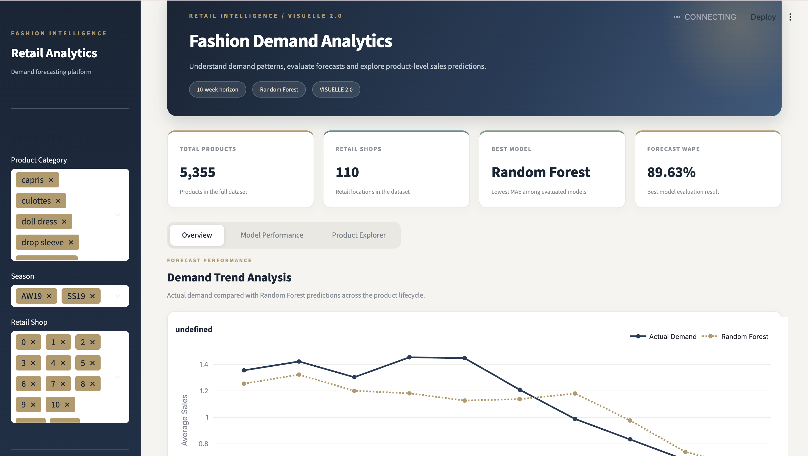

# Fashion Demand Forecasting & Retail Analytics

An end-to-end machine learning project that explores fashion retail demand patterns, forecasts future product sales and presents insights through an interactive analytics dashboard using the **VISUELLE 2.0** dataset.

## Project Overview

Accurately forecasting product demand is important in fashion retail because demand can change throughout a product's lifecycle. Poor forecasts can contribute to overstocking, stock shortages and inefficient inventory planning.

This project develops a machine learning-based demand forecasting solution to predict future product sales using early sales observations and product-related information.

It also provides an interactive Streamlit dashboard for exploring demand trends, comparing model performance and examining individual product forecasts.

## Objectives

- Explore fashion retail sales patterns across products, shops and seasons.
- Perform exploratory data analysis to identify demand trends.
- Prepare and transform data for machine learning.
- Develop and evaluate multiple demand forecasting models.
- Predict future sales using the initial product sales observations.
- Compare forecasting performance using MAE, RMSE and WAPE.
- Build an interactive dashboard to communicate forecasting insights.

## Dataset

**VISUELLE 2.0 – The Multi-Modal Universe of Fast-Fashion**

The dataset contains fashion retail sales information across multiple products, shops and seasons.

| Dataset characteristic | Details |
|---|---:|
| Products | 5,355 |
| Retail shops | 110 |
| Product categories | 27 |
| Seasons | 6 |
| Sales observation period | 12 lifecycle weeks |
| Training records | 96,166 |
| Testing records | 10,684 |

The dataset includes weekly sales observations and product-related attributes such as category, colour, fabric, season, retail shop and release date.

## Methodology

### 1. Data Understanding and Preparation

- Inspected the available dataset files and their structures.
- Examined data types, missing values and dataset consistency.
- Prepared training and testing datasets using the provided benchmark splits.
- Combined relevant sales records and product attributes.
- Created model features using product information, release dates and initial sales observations.

### 2. Exploratory Data Analysis

Investigated:

- Average weekly product demand.
- Total sales across product lifecycle weeks.
- Distribution of total product demand.
- Demand patterns during early and later lifecycle stages.
- Differences between initial sales and future demand.

The analysis showed a general decline in average sales as products progressed through their lifecycle.

### 3. Feature Engineering

The forecasting models use:

- Product category
- Product colour
- Fabric
- Season
- Retail shop
- Release month
- Release year
- Week 0 sales
- Week 1 sales
- Total sales during the first two weeks

The first two weeks are used as the initial observation period to predict sales for the following ten lifecycle weeks.

### 4. Model Development

The following approaches were evaluated:

- Baseline Forecast
- Random Forest Regressor
- Extra Trees Regressor

The baseline provides a reference point using the average of the first two weeks of sales.

Random Forest and Extra Trees were evaluated as machine learning alternatives for capturing relationships between product attributes and future demand.

### 5. Model Evaluation

Models were evaluated using:

- **MAE (Mean Absolute Error):** Measures the average absolute difference between actual and predicted sales.
- **RMSE (Root Mean Squared Error):** Penalizes larger prediction errors more heavily.
- **WAPE (Weighted Absolute Percentage Error):** Measures total absolute prediction error relative to the total absolute actual demand.

### Model Results

| Model | MAE | RMSE | WAPE |
|---|---:|---:|---:|
| Baseline | 1.2287 | 1.7385 | 109.00% |
| Random Forest | **1.0103** | **1.5468** | **89.63%** |
| Extra Trees | 1.0240 | 1.5622 | 90.84% |

**Best-performing model: Random Forest Regressor**

Random Forest achieved the lowest MAE, RMSE and WAPE among the evaluated models.

Compared with the baseline, it improved:

- MAE by approximately 17.78%.
- RMSE by approximately 11.02%.
- WAPE by approximately 19.37%.

These results indicate improved forecasting performance over the baseline, although prediction errors remain substantial.

## Interactive Dashboard


The project includes a Streamlit dashboard built to present forecasting results and support interactive data exploration.

### Dashboard Features

- Business overview with key performance indicators.
- Weekly actual versus predicted demand visualization.
- Model performance comparison using MAE, RMSE and WAPE.
- Interactive product category, season and retail shop filters.
- Product-level actual versus predicted sales exploration.
- Forecast summary metrics for selected product-retail records.

### Dashboard Technologies

- Streamlit
- Plotly
- Pandas

## Technology Stack

| Area | Technologies |
|---|---|
| Programming | Python |
| Data manipulation | Pandas, NumPy |
| Data visualization | Matplotlib, Seaborn, Plotly |
| Machine learning | Scikit-learn |
| Dashboard | Streamlit |
| Development | Jupyter Notebook, VS Code |
| Version control | Git, GitHub |

## Project Structure

```text
fashion-demand-forecasting-analytics/
│
├── dashboard/
│   ├── app.py
│   └── data/
│       ├── model_comparison.csv
│       ├── forecast_data.csv
│       └── weekly_comparison.csv
│
├── data/
│   ├── raw/
│   └── processed/
│
├── notebooks/
│   ├── 01_data_understanding.ipynb
│   ├── 02_exploratory_data_analysis.ipynb
│   └── 03_demand_forecasting.ipynb
│
├── .gitignore
└── README.md
```

## Limitations

- Forecasting performance is not sufficiently accurate for fully automated inventory decisions without further validation.
- The model uses an initial two-week observation period to predict the following ten weeks.
- Zero sales observations may reflect product availability limitations rather than an absence of customer demand.
- The model uses selected product attributes and early sales information rather than the complete multimodal dataset.
- Results are based on the provided historical benchmark dataset and do not represent live retail demand.

## Future Improvements

- Explore additional product, customer and external contextual features.
- Investigate more advanced forecasting techniques.
- Improve prediction accuracy through further feature engineering and validation.
- Explore inventory-aware forecasting approaches.
- Enhance dashboard functionality with additional business insights.

---

**Project Focus:** Data Science | Machine Learning | Demand Forecasting | Retail Analytics | Data Visualization